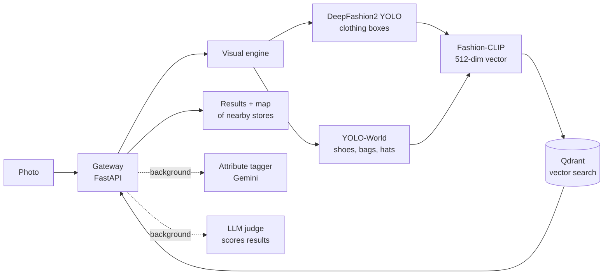

# Locus: visual fashion search for local stores

Take a photo of an outfit, tap the item you want, and Locus finds similar products in stores near you.

**Try it:** [Live demo on Hugging Face](https://huggingface.co/spaces/TatianaNohra/locus) (if it was asleep, the first load takes about a minute while the models start)

<!-- Demo video: drag the .mp4 into this README on GitHub to embed it here -->

Built by **Tatiana Nohra** with **Marc El Nawar** for AI in Industry (EECE 503N) at the American University of Beirut. The original course repo, with its full commit history, is [Nohra2005/locus](https://github.com/Nohra2005/locus).

---

## Results

Measured on a hand-labelled set of 35 search photos (`mlops/golden_dataset.json`), on the original Azure deployment (course report, `report/locus_report.tex`):

| Search method | Right product in top 5 | MRR |
|---|---|---|
| Random | 3% | 0.01 |
| Keyword search on product titles and tags | 12% | 0.08 |
| **Locus (Fashion-CLIP image embeddings)** | **97%** | **0.91** |

The original database was deleted after the course, so the catalog is rebuilt from the stores' websites (`scripts/build_catalog.py`, run by the *Rebuild catalog* workflow). To check the numbers on the current catalog:

```bash
python mlops/eval_retrieval.py --gateway-url http://localhost:7860 --delay 6.5
```

Median search time is under 2 seconds on a 2-core CPU machine.

## How a search works



1. **Detection.** A DeepFashion2 YOLO model finds clothing. YOLO-World catches what it misses (shoes, bags, hats, coats). If both miss, the whole image is used.
2. **Embedding.** The selected item is cropped and turned into a vector with Fashion-CLIP.
3. **Search.** Qdrant returns the closest products, filtered by category. Small accessories use a 70% image / 30% text blended vector, because image-only search was noisy for them.
4. **Background checks.** Gemini extracts attributes (colour, style, material) so users can refine a search. An LLM judge scores each result. A product that scores very low in the top 3 twice is removed from the catalog automatically.

## Testing and CI/CD

About 150 tests across five files:

| File | Type | What it checks |
|---|---|---|
| `tests/test_vectorizer.py` | Unit | Category voting, shoe types, label matching. No models needed. |
| `tests/test_smoke.py` | Smoke | Every service is up, the index is populated, all 14 categories exist. |
| `tests/test_pipeline.py` | Integration | Search, detect, feedback, rate limits, CORS, attribute tagging. |
| `tests/test_auth_store.py` | Integration | Store accounts: bcrypt, JWT expiry, registration, catalog management. |
| `tests/test_e2e.py` | End to end | The deployed system returns valid results. |

GitHub Actions in this repo:

- **`ci.yml`** runs unit tests, builds the frontend, builds the full Docker image, starts it, and runs the end-to-end tests against the running container.
- **`deploy-space.yml`** runs after CI passes on `main`. It pushes the code to the Hugging Face Space, waits for it to rebuild, and runs the end-to-end tests against the live demo.

In the original production setup on Azure, the pipeline also rolled the three images onto Kubernetes (K3s) and ran an **LLM-judge quality gate** (`mlops/ci_eval.py`): the build failed if search quality dropped below the saved baseline in `mlops/ci_baseline.json`.

## Retraining from user feedback

`mlops/retrain_clip.py` closes the loop between user ratings and the model:

1. Every two days, it checks whether enough products have new ratings.
2. It builds training pairs from the ratings and fine-tunes Fashion-CLIP with **LoRA** (rank 4, about 68K trainable parameters, about 35 minutes on 2 CPU cores).
3. It evaluates the new adapter on the 35-photo test set (hit@5, hit@10, MRR) and only promotes it if it beats the current one.
4. The visual engine loads the new adapter in memory through `POST /reload-adapter`, without restarting the service.

Every run is logged to MLflow, including the judge prompt version.

## Production setup (in this repo, not running in the demo)

| Folder | What it is |
|---|---|
| `k8s/` | Kubernetes manifests (deployments, services, ingress, secrets template) |
| `monitoring/` | Prometheus scrape config, 10 alert rules, provisioned Grafana dashboard |
| `mlops/` | Evaluation, LoRA training, MLflow tracking, judge calibration, golden dataset tools |
| `gateway/repair_broken_links.py` | Scheduled job that finds dead product images and hides them from results |

The Azure deployment cost about $40 a month, so it is shut down. This demo runs the same gateway, visual engine and frontend code in one container on Hugging Face's free tier, with the catalog loaded from a file.

## What the demo changes

- One container instead of four Kubernetes deployments (`Dockerfile`, `start.sh`).
- Qdrant runs inside the container. The catalog is loaded at startup from `data/catalog.jsonl.gz`, which the *Rebuild catalog* workflow creates by scraping the stores in `data/stores.json` and embedding every product with the real visual engine.
- `gateway/demo_app.py` blocks store admin, catalog editing and retraining endpoints, so visitors can search but cannot change the catalog. `gateway/main.py` is unchanged.
- The LLM judge scores the top results of a search in **one** call (`gateway/judge_batched.py`) instead of one call per result, so it fits free-tier quotas. Gemini is tried first and Groq second, each with per-minute and per-day caps (`shared/free_llm.py`). With no key set, or when the budget is used up, results keep their CLIP score and search is unaffected. `GET /llm-status` shows the remaining budget.

## Run it yourself

```bash
docker build -t locus .
docker run -p 7860:7860 locus
# open http://localhost:7860
```

Optional: `-e GOOGLE_API_KEY=... -e GROQ_API_KEY=...` turns on attribute tagging and the judge.

## Stack

Python, FastAPI, PyTorch, Ultralytics YOLO, Hugging Face Transformers (Fashion-CLIP), PEFT (LoRA), Qdrant, React, Vite, Tailwind, Leaflet, Docker, Kubernetes (K3s), GitHub Actions, MLflow, Prometheus, Grafana, Azure.
